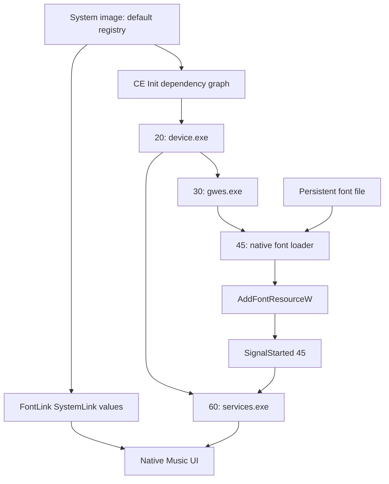

# 开机字体机制 / Startup font architecture



原方案在系统分区的 Fonts 目录放字库和加载器；默认注册表同时提供字体链接与启动依赖。
字体链接保留系统现有 Zegoe 字体名称，将缺失字符导向已加载的 CJK 字族。

The successful approach stores the font and native loader on persistent storage. The image's
default registry supplies both font linking and Init ordering. Existing Zegoe UI family names
are retained; missing characters are linked to the loaded CJK family.

## 为什么不能只运行一次应用 / Why a one-time application is insufficient

一次 `AddFontResourceW` 可以在当次运行期间改善显示，但不会自动创建下一次开机的加载入口。
目标设备上的注册表刷新也曾返回不受支持。因此持久化需要镜像配置和持久文件共同配合。

A runtime font load alone does not create the next boot's startup entry. Registry flushing was
unsupported in the tested configuration. Persistence therefore needs both image configuration
and files that remain available after reboot.

## 启动依赖回归 / Startup dependency regression

必须满足 `30 → 45 → 60`。在 45 上添加对 60 的依赖，会与 60 对 45 的依赖形成环。
本项目的实际失败版仅运行到前置启动程序，字体及 FLAC 后续状态没有更新，并出现黑屏。
移除这个等待环后，设备恢复启动且解码器成功加载。

The dependency graph must allow `30 → 45 → 60`. Making 45 wait for 60 while 60 waits for 45
prevents either launch. An early `SignalStarted` inside the unlaunched executable cannot fix it.
The public graph validator and regression test check this exact failure pattern.

## 数据传输不等于解码 / Transfer is not decoding

```text
Windows file copy
    -> standard MTP object transfer + metadata
    -> native music-library entry
    -> source-filter selection (including fLaC header recognition)
    -> FLAC decoder loaded on boot
    -> PCM output
```

MTP、音乐库、解码器和封面关联分别处理不同的工作。源文件完整存在不保证歌曲已登记，
歌曲已登记也不保证时长、封面和实际播放全部正常。

MTP transfer, library metadata, source selection, decoder loading and artwork association are
separate responsibilities. An intact source file alone does not prove a usable native track.
