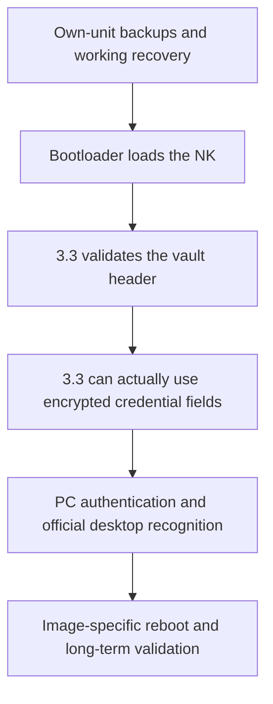

# 1.0 TEST → 3.3：失败原因与代码解析 / Failure analysis and code map

[中文新手教程](zh-CN/upgrade-1.0-test-to-3.3.md) · [English guide](en/upgrade-1.0-test-to-3.3.md)

## 研究中真正分开的三个问题 / Three separate problems



一代 30G 的该台 TEST 机器不能直接靠换 NK 完成升级。可见的黑屏是症状，
不是一个可以对所有机器通用地跳过的“黑屏限制”。
离线启动器执行、系统内部校验诊断、原机回退和真实 USB 认证提供了不同层面的证据。

On this unit, replacing NK alone was insufficient. A black screen was a symptom,
not evidence of one universal black-screen restriction. Loader emulation, OS-level
diagnostics, physical rollback and actual USB authentication answered different questions.

## 外层校验通过，不代表内部字段可用 / Header integrity is not credential usability

在分析过的 64 KiB 旧布局中，32 字节头部包含摘要信息。
旧校验上下文使用值 8，新校验上下文使用值 11。
只改头部的离线模型同时出现“新完整性检查通过”和“私钥内部一致性失败”。
完整 38 字段转换模型保留明文含义，并通过对应的内部一致性检查。

The modeled header-only transition passed outer integrity while failing RSA
consistency under the new field decoding path. Full-field rewrap preserved the
analyzed field plaintexts in the model. These are explicitly software-model results,
not proof that every hardware encryption call completed on the physical unit.

字段地图由 [runtime.py](../tools/upgrade/runtime.py) 定义：

| Offset | Length | Count |
| --- | --- | --- |
| `0x3C0` | `0x2B0` | 1 |
| `0x670` | `0x30` | 1 |
| `0x6A0 + i * 0x28` | `0x28` | 33 (`i = 0..32`) |
| `0xBC8`, `0xBE8` | `0x20` | 2 |
| `0xC28` | `0x18` | 1 |

头部 `0x00..0x1F` 单独处理。公开证书区域 `0x20..0x3BF` 在该转换中保留。
这些是针对分析过的固件和 vault 布局的偏移，不能当作所有 Zune 的通用结构定义。

## AUTH196 实际做了什么 / What AUTH196 changes

原构建脚本的工作已整理为 [build_upgrade.py](../tools/upgrade/build_upgrade.py)，只在电脑离线生成文件。

1. 对原版 NK 使用固定 SHA-256，先拒绝未经核对的程序版本。
2. 保留原 CEDDK 代码，将原生兼容例程放进已检查的最后一页可执行空间；检查与其他模块的地址冲突。
3. 将原 KeyVault 完整性调用重定向到该例程。
4. 把本机旧加密 vault 压缩后作为私有 ROM 文件 `\Windows\ZV194.dat` 加入。
   使用原本的 `ceconfig.h` 数据文件表项作为槽位，不替换任意程序模块。
5. 在该诊断版里将已定位的安全写处理入口设为失败返回，阻止它承担永久安全区迁移。
6. 更新 ROM 文件指针、长度、物理结束范围以及 CE BIN 记录校验和，并验证重建后的全部字节。

The public builder follows those exact operations. It does not claim to add a valid
Microsoft signature, change the bootloader's acceptance policy, or support other
source images. The historical TEST loader/policy and actual trial provided the
installation context. Container checksum validity alone is insufficient to boot.

## ARM 例程怎样工作 / Native routine

实际汇编源在 [rewrap_runtime.asm](../tools/upgrade/rewrap_runtime.asm)。
[runtime.py](../tools/upgrade/runtime.py) 为其填入当前本地输入的 SHA-1、随机日志标识和字段表。
没有硬编码维护者的 vault 内容、私钥、芯片密钥或原机身份。

The routine checks the expected buffer size, callback and security context. It
backs up the incoming RAM vault before replacing that buffer with the pinned ROM
source. It checks source size and digest, converts fields using the historical
software-decrypt path and hardware-backed new path, checks each encrypt/decrypt
roundtrip, rebuilds the header and invokes the original integrity validator.
Handled failures restore the incoming RAM buffer. An actual hardware hang is not
the same as a handled error; it cannot be promised to return normally.

进度日志用 `CREATE_NEW` 创建随机命名文件，不覆盖已有同名文件。日志可能包含转换后密文，
因此仍必须保密。阶段 `4000+i` 位于第 i 个硬件加密调用之前，`999` 表示例程走到收尾日志阶段。
阶段号不是“所有字段已经真机验证通过”的替代物；缺少完整日志就不能作出该结论。

The final full physical conversion journal was not completely retrieved in the
recorded work. Actual successful boot, same-unit authentication and the user-visible
desktop icon are physical observations; they do not turn modeled field counts into
a fully captured hardware trace.

## 为什么认证 0x2020 不能单独定性 / Authentication diagnosis

公开测试客户端证书在该 TEST 根下不匹配。原版 3.3 验证器的离线检查发现：
本机证书可以接受，而公开 fixture 证书不接受。
后来用本机已有证书和仅在主机内存中使用的私钥，真实完成挑战与受保护枚举，
用户再确认官方 Zune 软件出现设备图标。

The public client fixture's refusal was independent evidence from the field
encoding issue. A `0x2020` response alone therefore did not prove broken RSA,
failed conversion, or failure to boot. Source code here does not include a host
private identity, a generic authentication certificate or a reusable device vault.

## USB transfer and commit

以下为历史安装程序的状态机记录。`app/zzune/transfer.py` 现在实现了对应的受限实验状态机，
仍不是已经真机验收的通用 USB 后端：

```text
GetDeviceInfo (0x1001)
    -> exact same-unit identity and expected firmware
GetObjectHandles (0x1007, firmware format 0xB802)
    -> empty pending firmware queue
SendObjectInfo (0x100C)
    -> storage 0x10001, destination name nk.bin, format 0xB802
SendObject (0x100D)
    -> complete upload acknowledged
GetObjectInfo (0x1008)
    -> expected size and name, when supported
GetPartialObject (0x101B)
    -> bounded chunks, byte-exact full verification on normal 1.0 interface
GetObjectHandles
    -> only the verified staged object
Commit (0x9204), ONCE
    -> observe reboot; never automatically retry after disconnect
```

身份、能力、句柄、队列和读取长度都必须由本次会话取得并检查，不能从示例复制设备句柄。
历史恢复接口接受了原 NK 写回，但不支持相同的完整暂存回读。
没有回读能力时应如实记载“传输确认”，不能伪造 `full_readback_verified`。

The reviewed local research installers are not copied verbatim here because they
contain fixed private paths, per-device identity and state from old sessions.
Publishing those unchanged would create both privacy problems and a misleading
cross-device installer. The new `app/` backend parameterizes device identity,
uses private journals and limits supported builds. Its packaged worker passed a
controlled workflow on one additional supported unit; see [the hardware report](assistant-hardware-20261104.md).

## 源码入口 / Code map

| File | Purpose |
| --- | --- |
| [check_backups.py](../tools/upgrade/check_backups.py) | Validate existing local NK/NOR/disk-prefix/vault backups; never creates backups. |
| [ce_bin.py](../tools/upgrade/ce_bin.py) | Reject corrupt, truncated, overlapping and out-of-range BIN records; reconstruct checksums. |
| [ce_lzx.py](../tools/upgrade/ce_lzx.py) | Windows MakeCAB blocks plus externally supplied independent CE decompression check. |
| [runtime.py](../tools/upgrade/runtime.py) | Field table and parameterized ARM assembly using owner-local inputs. |
| [rewrap_runtime.asm](../tools/upgrade/rewrap_runtime.asm) | Actual historical ARM compatibility and progress journal routine. |
| [build_upgrade.py](../tools/upgrade/build_upgrade.py) | Construct and audit the private AUTH196-derived NK offline. |
| [test_upgrade.py](../tests/test_upgrade.py) | Portable structural/input-binding regressions using synthetic data. |
| [upgrade-reproduction.json](../evidence/upgrade-reproduction.json) | Sanitized observed results, local reproduction and publication limits. |

## 验证边界 / Validation boundaries

- **Public portable tests:** container validation, field bounds, input digest/nonce binding,
  source-version refusal and backup consistency checks. They use synthetic data.
- **Local private reproduction:** generated ARM and NK bytes exactly matched the historical
  AUTH196 inputs/output. This was verified using both the retained decoder and the public
  upstream decoder. Generated images remain private.
- **Historical native controls:** 14 ARM-model cases covered success and failures using
  modeled crypto/hardware APIs plus original validation code. This test environment is
  not bundled as Microsoft ROM code.
- **Physical observations:** specific-unit boot, protocol challenge, rollback and desktop icon.
- **Unfinished:** universal USB tooling, complete permanent credential migration, and broad
  cross-device/cold-boot validation of the final desktop-compatible adaptation.
